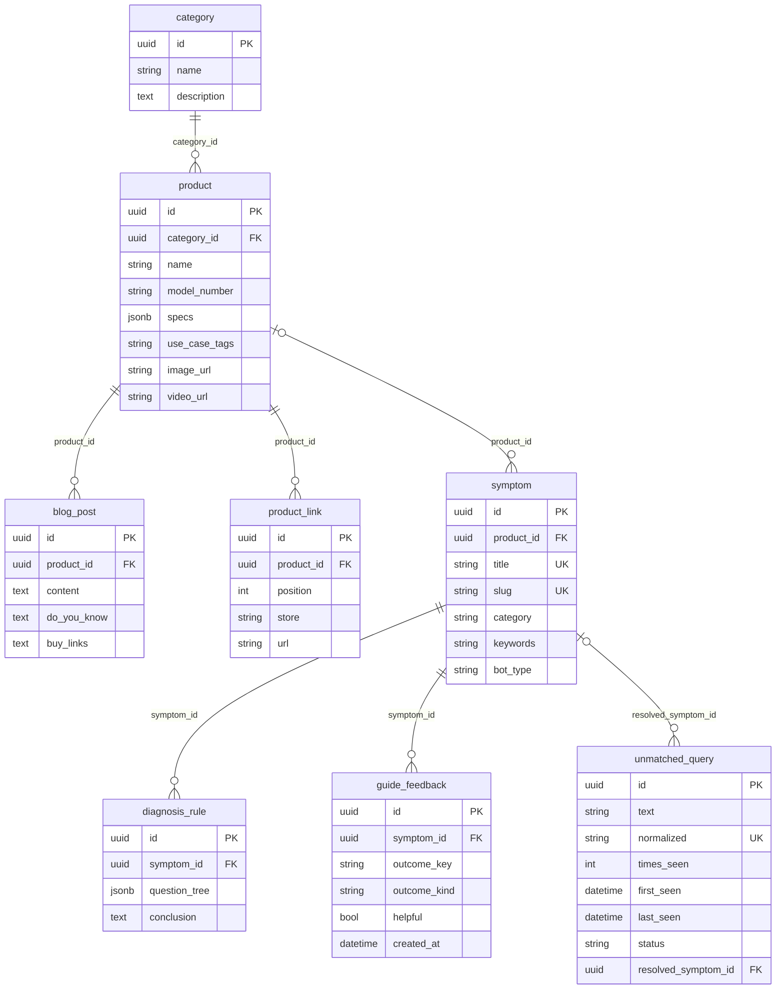

# Hardware Hub: database diagram

Generated from the SQLAlchemy models by `python -m app.db.erd --markdown`. Do not edit by hand:
change a model and run it again.

PK = primary key, FK = foreign key, UK = covered by a unique index.
A line from `a` to `b` means one `a` can have many `b`. A link that may be empty
(`symptom.product_id`, `unmatched_query.resolved_symptom_id`) is drawn with a zero-or-one end.



## What each table is for

| Table             | Purpose                                                                                                                                             |
| ----------------- | --------------------------------------------------------------------------------------------------------------------------------------------------- |
| `blog_post`       | The plain-English write-up and 'Do you know?' note shown on a product page. Its buy_links text is a legacy field: store links live in product_link. |
| `category`        | A hardware category (CPU, RAM, Storage ...).                                                                                                        |
| `diagnosis_rule`  | The decision tree (JSON) of a guide. One per guide.                                                                                                 |
| `guide_feedback`  | Anonymous 'did this fix it?' votes on a final answer. No user, no IP, no free text.                                                                 |
| `product`         | A catalog part with its specs (JSON), tags, image and video links.                                                                                  |
| `product_link`    | One to three store links per product; position 0 is the 'Check price' link.                                                                         |
| `symptom`         | A troubleshooting guide: its title, area, keywords, bot type and URL slug.                                                                          |
| `unmatched_query` | Chat messages that matched no guide (text only), once per wording with a counter.                                                                   |

## Tables that exist but no feature uses yet

They are left in the models so nothing breaks, and are not drawn above.

| Table                 | Why it is unused                                            |
| --------------------- | ----------------------------------------------------------- |
| `app_user`            | there are no user accounts                                  |
| `comparison`          | comparisons are computed on the fly, nothing is saved       |
| `comparison_item`     | comparisons are computed on the fly, nothing is saved       |
| `compatibility_rule`  | planned for the build checker                               |
| `recommendation_rule` | an earlier budget-bot design, replaced by rule-based guides |
| `use_budget_profile`  | an earlier budget-bot design, replaced by rule-based guides |

An older chat database may also still hold `chat_session`, `chat_log` and `feedback`
tables from before the chat became stateless. No model uses them and they are harmless.

## Making an image

```
npm install -g @mermaid-js/mermaid-cli
python -m app.db.erd > docs/erd.mmd
mmdc -i docs/erd.mmd -o docs/erd.svg
```
